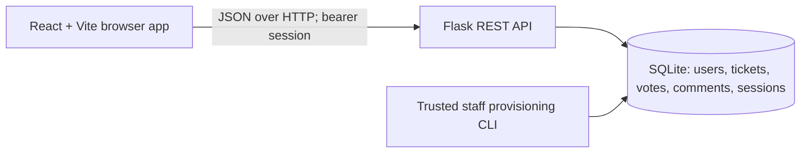

# HostelCare — Project and Maintenance Guide

Updated: 27 October 2026

This guide describes the repaired local implementation of the hostel grievance and maintenance system. It covers architecture, permissions, setup, API contracts, data migration, verification, and deployment. Code and documentation are versioned together on the review branch codex/hostel-access-redesign. Render deployment is a separate operation.

## Repair summary

| Issue | Repair |
| --- | --- |
| Signup treated a success message as a user | Signup and login share a user/token/expiry contract |
| No protected API session | Hashed opaque tokens, twelve-hour expiry, identity restoration and revocation |
| Public Admin selection and client-supplied identity | Student-only signup, trusted staff CLI, session-derived user IDs |
| Hostel privacy and staff access | Students are restricted to their registered hostel; wardens and admins manage every hostel |
| Comments table unused | Read/post endpoints and per-ticket discussion UI |
| Refresh discarded login | Tab-scoped session storage and server identity check |
| Request failures and repeated actions | Consistent errors, timeout, cancellation, pending controls and retry |
| Duplicate votes were silent | Conflict response, has_voted state and disabled UI |
| Required room for shared-facility issue | Optional floor/room with clear display defaults |
| Destructive schema setup and seeding | Idempotent schema initialization and populated-database seed refusal |
| Mixed new timestamps and debug exposure | UTC for new records, stable resolution time, debug disabled |
| Duplicate styling and inaccessible fields | Consolidated styles, labels, focus indicators, native modal |
| Per-ticket vote-count queries | SQL aggregation in ticket list |
| Missing project documentation and tests | Project guide, setup READMEs, environment examples and regression suites |

## Purpose and workflow

Students report maintenance problems in KP-1, KP-2, or KP-3. Categories are Wi-Fi, AC, Water Purifier, Sanitation, Mess Food, and Other. Tickets begin as Open. An administrator or any warden can move a ticket to In Progress or Resolved, or reopen it. A ticket that remains unresolved for more than 48 hours is flagged overdue when the API reads it.

Students can only read, create, vote on, and discuss tickets belonging to their registered hostel. Other-hostel tickets, discussions, and totals are blocked by the API, including direct requests with forged filters or guessed ticket IDs. Votes represent shared impact, with one vote per student per ticket. Resolved tickets cannot receive new votes; discussion remains available.

Students enter their registered hostel only. Wardens and administrators initially see all hostels and can filter to KP-1, KP-2, or KP-3. Counts always cover every status in the selected block, even when the ticket list has a status filter. Sorting supports newest first and most votes.

## Architecture and source map



| Location | Responsibility |
| --- | --- |
| Frontend: src/main.jsx | React entry point and StrictMode |
| Frontend: src/App.jsx | Session restoration and authenticated entry |
| Frontend: src/Auth.jsx | Landing page, student/staff portal, hostel selection, registration/login |
| Frontend: src/Dashboard.jsx, Sidebar.jsx, OverviewPanels.jsx | Workspace, navigation, live totals, filters, hostel insights |
| Frontend: src/TicketCard.jsx, TicketForm.jsx, components.jsx | Tickets, discussions, native dialogs, shared UI |
| Frontend: src/useOverview.js, tickets.js | Snapshot loading, refresh, search and list filters |
| Frontend: src/api.js | Configurable API URL, bearer token handling, timeouts, cancellation, readable errors |
| Frontend: src/App.css | Shared styling, keyboard focus, responsive layouts |
| Frontend: src/index.css | Entry stylesheet; duplicate app rules removed |
| Frontend: tests/api.test.js | Request and session regression tests |
| Backend: app.py | API, validation, sessions, authorization, safe schema initialization |
| Backend: schema.sql | Idempotent tables and indexes |
| Backend: manage.py | Staff account provisioning through trusted server access |
| Backend: seed.py | Optional demo data; refuses populated databases |
| Backend: test_app.py | Isolated API and migration regression tests |

React uses component state rather than a router. Dashboard queries are keyed by their filters; a superseded request is canceled and cannot overwrite a newer result. Mutations show progress, prevent repeated clicks while pending, report failures, and refresh the data after success. Ticket listing aggregates votes in SQL rather than running separate vote queries for every displayed ticket.

## Roles and permissions

Permissions are checked on the server for every protected request. Changing a browser variable or submitting another user's ID does not grant access.

| Capability | Student | Warden | Admin |
| --- | --- | --- | --- |
| Public signup | Student account only | Provisioned through CLI | Provisioned through CLI |
| Read tickets, stats, discussions | Registered hostel only | All blocks | All blocks |
| Create ticket | Assigned block | No | No |
| Upvote unresolved ticket | Assigned block, once | No | No |
| Update ticket status | No | All blocks | All blocks |
| Post comment | Registered hostel only | All blocks | All blocks |

A student without a valid registered hostel cannot obtain a hostel-wide view. A warden account may have a descriptive home hostel, but it does not restrict staff access. Students may report shared facilities without a floor or room number. Staff accounts cannot be requested through public signup.

## Local setup

### Backend

Requirements: Python 3.10 or newer. Verification used Python 3.12.10, Flask 3.1.3, flask-cors 6.0.5, and Werkzeug 3.1.8.

From the backend directory in PowerShell:

```powershell
python -m venv .venv
.\.venv\Scripts\Activate.ps1
python -m pip install -r requirements.txt
$env:DATABASE_PATH = 'C:/hostel-ticketing-backend/hostel_ticketing.db'
$env:FRONTEND_ORIGINS = 'http://localhost:5173,http://127.0.0.1:5173'
python app.py
```

The API listens on port 5000 by default. Tables are initialized automatically without deleting existing records. The development server runs with debug disabled. DATABASE_PATH should point to a file in an existing writable directory.

Environment variables:

| Variable | Meaning |
| --- | --- |
| DATABASE_PATH | SQLite file; defaults to hostel_ticketing.db beside app.py |
| FRONTEND_ORIGINS | Comma-separated exact allowed frontend origins, without trailing slashes |
| PORT | Development server port; defaults to 5000 |

The backend .env.example is a configuration reference. The backend does not automatically load .env files; set variables in the shell or deployment environment.

### Frontend

Requirements: a Node.js version supported by the installed Vite release; verification used Node 22.22.3.

From the frontend directory:

```powershell
npm ci
Copy-Item .env.example .env.local
npm run dev
```

Open http://localhost:5173. Vite loads VITE_API_URL from .env.local. Restart Vite after changing it. During development the default API URL is http://localhost:5000. Production builds retain the existing hosted backend as a fallback; configure VITE_API_URL explicitly for other deployments.

```powershell
npm test
npm run lint
npm run build
```

### Optional isolated demo data

Run seed.py only against an empty demo database:

```powershell
$env:DATABASE_PATH = 'C:/hostel-ticketing-backend/demo.db'
python seed.py
python app.py
```

The demo includes ten students, two wardens, one administrator, eighteen tickets, and sample votes. The script refuses to seed an existing populated database. Do not use demo credentials in a real deployment.

Demo-only accounts:

| Role | Email | Password |
| --- | --- | --- |
| Student | astha@kiit.ac.in | password123 |
| Warden KP-1 | warden.kp1@kiit.ac.in | adminpass |
| Admin | admin@kiit.ac.in | adminpass |

### Create real staff accounts

Run on the server that owns the intended database:

```powershell
python manage.py create-staff --name "Hostel Administrator" --email admin@example.edu --role admin
python manage.py create-staff --name "KP-1 Warden" --email warden@example.edu --role warden --block KP-1
```

Passwords are entered through a hidden prompt and confirmed. A warden block is optional descriptive metadata; all wardens have access across hostels. Existing emails are rejected rather than overwritten. There is no public role-change or staff-registration endpoint.

## Authentication and sessions

Signup and login return the same structure:

```json
{
  "user": {
    "id": 14,
    "name": "Example Student",
    "email": "student@example.edu",
    "role": "student",
    "hostel_block": "KP-1"
  },
  "token": "<opaque random token>",
  "expires_at": "2026-10-28 00:00:00Z"
}
```

The expiry above is illustrative. Actual sessions expire twelve hours after creation. Requests use Authorization: Bearer followed by the token.

The server stores a SHA-256 digest of the randomly generated session token, not its raw value. Passwords use Werkzeug's salted scrypt hashing. Existing SHA-256 password hashes are accepted during login and upgraded to scrypt after successful authentication.

The browser keeps only the session token in sessionStorage. Refresh restores identity from GET /api/me; cached role information is never trusted. Browser-tab storage normally clears when the tab is closed, although browser session recovery may restore it. Server expiry remains authoritative. If browser storage is disabled, authentication works in memory but cannot survive refresh.

Logout revokes the current token on the server before clearing the browser's state. A protected request returning 401 returns the interface to sign-in. A late failure from an older token cannot clear a newer session. Requests time out after 45 seconds with a retry message; canceled screen requests are ignored.

## API reference

Base URL in local development: http://localhost:5000. Bodies and responses use JSON. Except signup, login, and health, every endpoint requires a valid bearer session.

| Method | Path | Input / behavior |
| --- | --- | --- |
| GET | /api/health | Public health result: status=ok; verifies the users table can be read |
| POST | /api/signup | name, email, password, hostel_block; optional role must be student |
| POST | /api/login | email, password; optional portal=student or staff; student portal requires the registered hostel_block |
| GET | /api/me | Returns current server-verified user |
| POST | /api/logout | Revokes current session |
| GET | /api/tickets | Optional hostel_block, status, sort=newest or votes |
| POST | /api/tickets | category, description, hostel_block; optional floor and room_no |
| PATCH | /api/tickets/{id}/status | status: Open, In Progress, or Resolved |
| POST | /api/tickets/{id}/vote | Empty JSON object; identity comes from session |
| GET | /api/tickets/{id}/comments | Ordered discussion, oldest first |
| POST | /api/tickets/{id}/comments | text |
| GET | /api/stats | Optional hostel_block; role scope always enforced |
| GET | /api/overview | Matching tickets and stats in one SQLite read snapshot; updated_at timestamp |

Ticket responses contain stored ticket fields plus vote_count, has_voted, and overdue. The user_id field supplied by a client is ignored for creation and voting; the authenticated identity is used instead.

Comment responses include id, ticket_id, text, author_name, author_role, and created_at. User emails and password hashes are not exposed in comments or authentication responses.

Stats return total, open, in_progress, resolved, overdue, and my_total. Student totals always belong to their registered hostel; my_total counts their own submissions. Staff can view all-hostel or selected-hostel counts.

Validation limits:

- Name: 1–100 trimmed characters.
- Email: up to 254 characters, normalized to lowercase, with basic structural validation and case-insensitive duplicate checks. Email ownership is not verified.
- New password: 8–128 characters.
- Description: 1–4000 trimmed characters.
- Floor and room: optional, up to 30 characters each.
- Comment: 1–2000 trimmed characters.
- Request body: at most 32 KiB.
- Block, category, status, and sort values must be from the supported lists.

Errors use {"error": "Readable message"} and appropriate HTTP codes: 400 for malformed or invalid input, 401 for absent/expired sessions or invalid credentials, 403 for insufficient permissions, 404 for missing tickets, 409 for conflicts such as duplicate votes/emails or resolved-ticket voting, and 413 for oversized requests. Unexpected server errors return a generic JSON message while details are logged server-side.

## Database and migration

Tables:

- users: identity, hashed password, role, assigned block.
- tickets: author, category, description, location, status, creation/resolution times.
- votes: ticket/user relationship with a unique pair constraint.
- comments: ticket/user relationship and discussion text.
- sessions: token digest, user relationship, expiry.

Foreign-key enforcement is enabled for API connections. New writes cannot create votes, comments, or tickets with missing referenced users/tickets. Initialization adds missing tables and indexes using IF NOT EXISTS. It does not drop tables, reset IDs, seed data, or rewrite historical timestamps.

New dates and overdue calculations use UTC. The browser renders dates in its local timezone. Historical timestamps have no timezone metadata; they are retained and interpreted as UTC. If older records were generated in a different local timezone, their original timezone must be established before a separate data correction.

Resolution sets resolved_at. Repeating Resolved preserves that timestamp. Reopening clears it. Overdue is calculated from the original creation time, so reopening an old ticket can immediately make it overdue again.

A migration dry run on a copy of the user's existing database retained 13 users, 20 tickets, 51 votes, and 0 comments. Its foreign-key consistency check passed. The original local database was not modified during verification.

Database files are excluded from source tracking. The previously tracked hostel_ticketing.db has been removed from Git's index while its local file is preserved. Removing it from the current source does not erase copies from Git history. Existing staff accounts are preserved; audit them before real deployment because the old public signup allowed selecting Admin.

Registration records the hostel selected by the student; this project has no institutional enrollment roster to verify residence independently. After registration, students cannot switch hostels through the UI, login selector, or API filter. Roster-backed residence verification can be added when the institution supplies an authoritative source.

## Ticket counts and refresh

The dashboard reads GET /api/overview to obtain a ticket list and counters from one database snapshot. API responses and browser requests disable caching. A new ticket is committed before its success response; the form then waits for an overview refresh. After successful creation, search/category/status/personal filters reset and sorting returns to newest so the new ticket is visible. A refresh failure is reported without resubmitting or duplicating the saved ticket.

The overview refreshes after successful mutations, every 30 seconds while the page is visible, when the browser regains focus, and when Refresh is pressed. In-flight silent refreshes are allowed to finish rather than repeatedly being canceled by the timer. Old hostel requests cannot overwrite a newer selection. Status and category filters affect the list, not hostel totals. The personal ticket count and hostel count are labeled separately. Resolving or reopening a ticket changes status totals without adding another raised ticket.

## Interface

The landing page has separate Student and Warden & admin portals and interactive KP-1/KP-2/KP-3 cards. Student login checks the chosen hostel against the stored account. Selecting Staff does not grant a student staff access. Signup remains student-only.

The workspace includes responsive navigation, personal tickets, hostel-specific or cross-hostel views, real search, category/status/overdue filters, vote sorting, resolution progress, category breakdowns, discussion updates, success notifications, and native keyboard-accessible dialogs. Supporting illustrations and icons are drawn in code; they do not require external image services. Reduced-motion preferences are respected. Desktop browser layout and workflows were checked; phone-specific browser emulation was unavailable in this session.

## Render deployment

Both repositories must be deployed together because the API now requires authentication headers and returns a new auth response format.

Backend configuration:

- Build: python -m pip install -r requirements.txt
- Start: gunicorn app:app --bind 0.0.0.0:$PORT --workers 1
- Health path: /api/health
- FRONTEND_ORIGINS: https://hostel-ticketing-frontend-17du.onrender.com
- DATABASE_PATH: an absolute path on a persistent disk, for example /var/data/hostel_ticketing.db

A persistent disk must be configured in the hosting account; merely setting DATABASE_PATH does not provision storage. Keep the deployment on one service instance while using SQLite.

Frontend configuration:

- Build: npm ci && npm run build
- Publish directory: dist
- VITE_API_URL: https://hostel-ticketing-backend.onrender.com

Vite embeds its API URL during the build, so changing it requires rebuilding the frontend.

Release procedure:

1. Back up the deployed SQLite database using SQLite's backup facility, or stop writes before copying the database file.
2. Review existing staff roles and replace public demo credentials before exposing a real service.
3. Prepare persistent storage, migrate the existing database file to that location, and set DATABASE_PATH.
4. Deploy source with the database excluded from Git; keep the actual database on persistent storage.
5. Deploy the backend. Startup initializes missing tables safely; do not put seed.py in a build or start command.
6. Provision required real staff accounts through manage.py.
7. Deploy the frontend with the correct VITE_API_URL.
8. Verify signup/login, refresh, student ticket creation, voting, comments, warden scope, status changes, and logout using an authorized test account.

Changes are stored on a review branch. No Render settings or live records were changed. Deployment remains a separate operation.

## Verification and scope

Automated checks:

- 24 backend tests: auth requirements, signup contract, session expiry/revocation, credential failures, legacy-hash migration, forged user IDs, role enforcement, student hostel isolation, staff access across hostels, portal validation, counter increments, vote uniqueness, comments, validation, missing records, overdue behavior, filters, stats, safe initialization, seed refusal, staff provisioning, and CORS.
- 12 frontend tests: four search/filter/count-preservation checks plus eight API-client checks covering bearer headers, public login behavior, expired-session handling, stale 401 protection, network errors, non-JSON failures, cancellation, and timeouts.
- Frontend lint and production build pass.

Browser checks used a separate disposable demo database. Verified wrong-hostel login rejection, a student workspace exposing only its registered hostel, the updated landing and dashboard, and ticket creation while a Resolved filter was active. The new ticket immediately appeared: KP-2 hostel total increased from 7 to 8, personal total from 2 to 3, and Open from 6 to 7. Wardens can sign into the Staff portal and manage every hostel. Earlier regression checks also covered signup, voting, comments, refresh persistence, logout, resolution, and expiry. Screenshots are supplied with this guide.

Regression commands:

```powershell
# Backend
python -m unittest -v

# Frontend
npm test
npm run lint
npm run build
```

Tests create temporary databases and do not use the real database. HOSTEL_TEST_TMP can override the temporary directory when running in a restricted environment.

This remains a small hostel application. Password reset, email verification, notifications, file attachments, immutable status history, staff assignment workflows, and distributed scaling are outside this implementation. Internet-facing operation should also add a login/signup rate limit at the deployment edge. These are follow-up capabilities, not features claimed by this repair.
