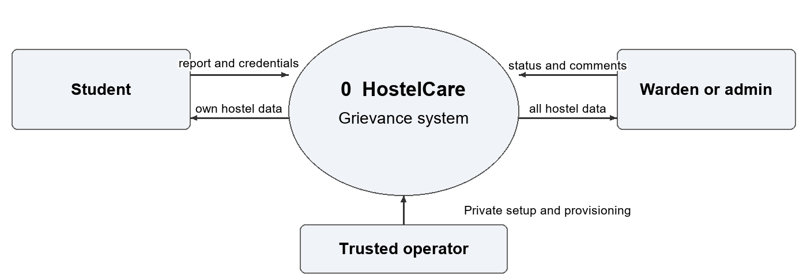
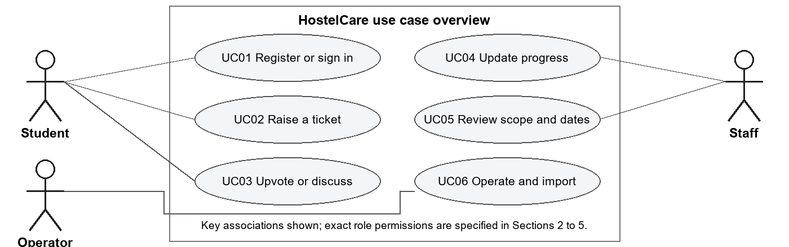
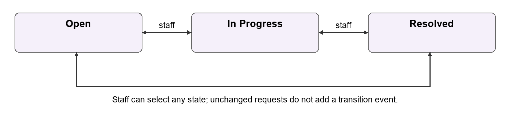
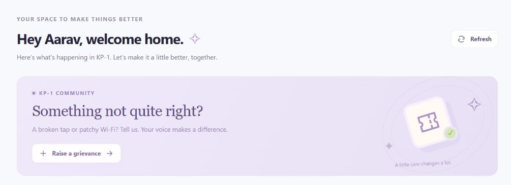
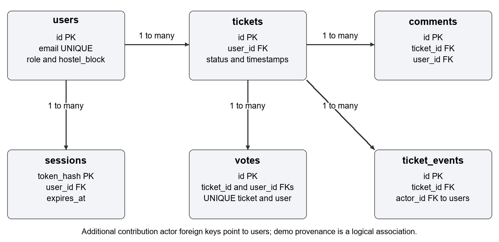

# Software Requirements Specification
## HostelCare Hostel Grievance Management System
SOFTWARE ENGINEERING - CS-02

KIIT

Submitted by

| Team member | Roll number |
| --- | --- |
| Sonali Kamila | 24051887 |
| Pratiksha Vyas | 2405217 |
| Astha Singh | 24052448 |

Version 1.0

28 October 2026

Project website: https://hostelgrievance.onrender.com/

This document specifies the requirements, interfaces, UI, database and validation of the implemented hostel grievance system. It includes the testing report and a requirements traceability matrix for academic evaluation.

<!-- PAGE -->
# 1 Introduction and document guide
## 1 1 Purpose and audience
This SRS defines the expected behaviour and acceptance criteria of HostelCare for the student team, Software Engineering evaluator, testers and maintainers. It follows a conventional SRS organization informed by IEEE 830 style and the requirements-engineering principles of ISO/IEC/IEEE 29148.

## 1 2 Scope
Students register and report maintenance problems in their stored hostel. Wardens and administrators manage grievances across all configured hostels. The release includes authenticated sessions, hostel access control, ticket creation, upvotes, comments, status changes, dated history, overdue indicators, filters, consistent dashboard counts and persistent storage.

The configured catalogue has 36 hostels: KP-1 to KP-25 and QC-1 to QC-11. These ranges were confirmed by the project owner; they are not presented as an independently verified official residence inventory.

## 1 3 Reading guide
| Section | Topic | Page |
| --- | --- | --- |
| 1 | Introduction and scope | 2 |
| 2 | Overall description and system context | 3 |
| 3 | Account and access requirements | 4 |
| 4 | Ticket and collaboration requirements | 5 |
| 5 | Dashboard and operational requirements | 6 |
| 6 | Use cases and business rules | 7 |
| 7 | User interface requirements | 8 |
| 8 | Database and entity relationships | 9 |
| 9 | External interfaces and API | 10 |
| 10 | Quality requirements and constraints | 11 |
| 11 | Testing strategy and validation parameters | 12 |
| 12 | Testing report and observed results | 13 |
| 13 | Traceability and acceptance | 14 |

## 1 4 Conventions and definitions
Shall denotes a mandatory release requirement; a target is a proposed acceptance value, not a measured result. FR01-FR34 are functional requirements; NFR01-NFR08 define quality requirements. SRS means Software Requirements Specification; API means Application Programming Interface; IST means UTC+05:30. A ticket is a grievance; an upvote signals shared impact; a session is authenticated access by an opaque bearer token. All recorded results refer to the 27 October 2026 baseline.
<!-- PAGE -->
# 2 Overall description and system context
## 2 1 Product perspective
HostelCare is a browser-based application. React and Vite provide the client, Flask provides the REST API, and Neon PostgreSQL 18 stores live records. Render hosts the frontend and API. Local development can use SQLite when DATABASE_URL is absent. The browser never receives database credentials.

## 2 2 User classes and authority
| User class | Permitted scope and actions |
| --- | --- |
| Student | Stored hostel only; create tickets, read, upvote unresolved tickets and discuss. |
| Warden | All 36 hostels; review, filter, discuss and change ticket status. |
| Administrator | Same ticket-management scope as warden; administrative identity. |
| Trusted operator | Server-side staff provisioning, configuration, release and migration. |

Portal selection does not grant privileges. A descriptive warden home hostel does not restrict staff access. There is no public staff registration or browser-based account-management console.

## 2 3 Objectives and assumptions
O1: enforce student hostel isolation. O2: support campus-wide staff oversight. O3: maintain accurate counters and durable data. O4: provide date tracking and history. O5: provide a reproducible academic demonstration.

The application requires JavaScript, Internet access, accurate server time and available hosting/database services. Student hostel choice is stored at registration but is not checked against an official residence database. Staff provisioning is trusted. Free-plan wake-up delays and usage limits are external constraints.
<!-- PAGE -->
# 3 Account and access requirements
All functional requirements are mandatory for this release. Verification references TC01-TC12 identify the grouped scenarios in the testing report. New student signup has a stricter email rule than staff or legacy login.

| ID | Required behaviour | Verification |
| --- | --- | --- |
| FR01 | The system shall publish 36 distinct KP/QC hostel codes. | Catalogue has 25 KP, 11 QC. |
| FR02 | Student signup shall require a name, 6-12 digit @kiit.ac.in email, 8-128 character password and valid hostel. | Valid input succeeds; invalid boundaries fail. |
| FR03 | Public signup shall create students only and reject warden/admin roles. | Staff-role request returns 403. |
| FR04 | Signup shall normalize email case and reject an existing normalized email. | Duplicate returns 409. |
| FR05 | Login shall verify credentials and return public user, opaque token and expiry; passwords shall be stored as salted hashes. | Login succeeds or returns 401; hash is not plaintext. |
| FR06 | Login shall reject the wrong role portal or a mismatched student hostel selection. | Wrong selection returns 403. |
| FR07 | Sessions shall expire after 12 hours, be revoked at logout and restore valid tab identity after refresh. | Expiry/revocation returns 401. |
| FR08 | Every student business request shall be restricted to the account's stored hostel, including guessed ticket IDs. | Other-hostel list/history/discussion/action returns 403. |
| FR09 | Wardens/admins shall be able to view and manage all hostels and filter one hostel. | Staff can access KP and QC. |
| FR10 | The API shall derive actor identity from the session and disclose author email only to its owner or staff. | Forged user_id has no effect; peers receive no author email. |

## 3 1 Email acceptance examples
Accepted new-student format: 24054001@kiit.ac.in. Rejected examples: student@gmail.com, student@kiit.ac.in, 24054001@other.ac.in and 24054001@kiit.ac.in.evil.com. The numeric part may contain 6-12 digits; syntax acceptance is not email-ownership verification.

Staff demo login may use a Gmail-formatted identifier because it is a provisioned staff account. The system does not enforce the student-signup email rule on all historical or staff logins. Selecting another hostel on the landing page never changes a stored account's permissions.
<!-- PAGE -->
# 4 Ticket and collaboration requirements
| ID | Required behaviour | Verification |
| --- | --- | --- |
| FR11 | An authenticated student shall create tickets only for their stored hostel; staff shall not create tickets. | Valid create returns 201; forbidden create returns 403. |
| FR12 | A ticket shall require a valid category and 1-4000 character description; floor and room are optional, at most 30 characters each. | Invalid input returns 400 with no partial ticket. |
| FR13 | A new ticket shall receive an ID, Open state, creation time and a creation history event. | Ticket and event refer to one saved record. |
| FR14 | Only staff shall change status to Open, In Progress or Resolved, including reopening. | Student/invalid state is rejected. |
| FR15 | A real status change shall append actor, old/new states and time. Resolution time shall remain stable on repetition and clear on reopening. | No duplicate transition on unchanged state. |
| FR16 | An unresolved ticket older than 48 hours shall be marked overdue when read. | Resolved tickets are never overdue. |
| FR17 | A student shall upvote an unresolved ticket only in their own hostel. | First eligible vote returns 201. |
| FR18 | One user-ticket vote shall be unique; new votes on Resolved tickets and staff votes shall be rejected. | Duplicate/resolved returns 409; staff returns 403. |
| FR19 | Authorized users shall read/post ordered comments, with session-derived author and 1-2000 character text. | Valid comment returns 201; invalid text returns 400. |
| FR20 | Authorized users shall read chronological creation/status history; discussion shall remain available after resolution. | Correct order and hostel check. |

## 4 1 Fixed catalogues
Categories: Wi-Fi, AC, Water Purifier, Sanitation, Mess Food and Other. Status values: Open, In Progress and Resolved. The HC prefix is display formatting for a ticket's integer identity.

An upvote is support, not automatic escalation. The 48-hour indicator is not a repair SLA. No ticket edit/delete, unvote, comment edit/delete, attachment or technician assignment operation is included.
<!-- PAGE -->
# 5 Dashboard and operational requirements
| ID | Required behaviour | Verification |
| --- | --- | --- |
| FR21 | Overview shall obtain tickets and counters from one consistent read snapshot. | All-status population matches total. |
| FR22 | Successful mutations shall refresh total, status and personal counts. | New ticket increases correct counters. |
| FR23 | The workspace shall support category/status/personal/overdue filters, ID/text/room search and newest/vote sorting. | List refinements preserve scope totals. |
| FR24 | From/To dates shall be inclusive IST creation dates; invalid/reversed dates shall be rejected. | Midnight boundary and invalid-date tests. |
| FR25 | Daily activity and All time/Today/Last 7 days/custom shortcuts shall reflect selected scope. | Fixed-date sample and daily totals agree. |
| FR26 | Pending actions shall show progress and prevent repeated client submissions; request failures shall be readable. | Pending UI and error regressions. |
| FR27 | Requests shall time out after 45 seconds; superseded loads shall be cancelled and stale 401 responses shall not revoke a newer login. | Timeout/cancellation/session tests. |
| FR28 | UI shall show role/hostel scope, labels, keyboard focus, responsive navigation and reduced-motion handling. | Source and representative browser checks. |
| FR29 | Trusted staff provisioning shall read passwords privately and reject account overwrites. | Operator CLI regression checks. |
| FR30 | Live records shall persist in PostgreSQL; local SQLite shall remain available without DATABASE_URL. | Hosted persistence and isolated tests. |
| FR31 | Startup shall add missing schema without dropping/reseeding existing records. | Reinitialization preserves records. |
| FR32 | A labelled synthetic batch shall contain 40 distinct grievances/accounts and import once without collisions or lost legacy records. | Fixture/append/repeat tests. |
| FR33 | Controlled migration shall pause business writes, copy and verify a consistent empty-target snapshot, exclude sessions and resume after cutover. | 503/read-only and migration checks. |
| FR34 | A read-only health check shall exercise storage, and versioned release/demo instructions shall identify the active deployment. | Health response and Git documentation. |

Hostel/date changes affect both data and totals. Status/category/search controls refine the visible list. The configured hostel is an account boundary, not independently verified evidence of residence. Client double-click prevention does not provide a server-side idempotency key for uncertain network retries.
<!-- PAGE -->
# 6 Use cases and ticket state model

## UC02 Raise a grievance
Actor: student. Preconditions: valid session, registered hostel, writes enabled. Main flow: open ticket form; select category; enter description and optional location; submit; API validates identity/hostel/fields; save Open ticket and creation event; refresh list and counters. Alternatives: invalid fields return 400; another-hostel request returns 403; expired session returns 401; migration mode returns 503. Postcondition: one valid submission increases total and Open count by one. Related: FR11-FR13, FR21-FR22.

## UC04 Update progress
Actor: warden/admin. Preconditions: staff session and existing ticket. Main flow: select ticket and new state; API locks the update, saves status/resolution time and appends a real transition; UI refreshes. Alternatives: student attempt returns 403; invalid state returns 400; absent ticket returns 404; unchanged state adds no transition. Postcondition: current state and history agree. Related: FR14-FR16, FR20.

Other use cases: UC01 register/sign in and restore scope; UC03 upvote or discuss an authorized ticket; UC05 inspect hostel/date totals and filters; UC06 provision staff, import demo records and release/migrate safely. These follow the corresponding requirements and test cases in the traceability matrix.

Staff may move between any of the three states. Resolved blocks new votes but permits authorized discussion. Overdue is a calculated indicator, not another stored status.
<!-- PAGE -->
# 7 User interface requirements

Representative deployed student workspace at the clean public address. The screenshot is a visual reference; the permission and count rules remain API obligations.

## 7 1 Screen responsibilities
| Screen or control | Required interaction |
| --- | --- |
| Landing and registration | Student or staff portal; KP/QC hostel selection for students; labelled fields and readable validation. |
| Student workspace | Assigned-hostel identity, personal/hostel totals, ticket form, filters, upvotes, comments and dated history. |
| Staff workspace | All-hostel directory, scope filters, status controls and campus totals. |
| Date controls | All time, Today, Last 7 days, From/To, daily activity and visible IST context. |
| Feedback and navigation | Pending/success/error states, refresh, sign out, visible focus and narrow-screen menu. |

## 7 2 Usability and accessibility criteria
Labels shall identify inputs; visible focus shall support keyboard use; dialogs and buttons shall be labelled; reduced-motion preferences shall be respected. Responsive layouts shall keep core actions available on narrow and desktop views. A full WCAG audit or browser/device certification is not claimed.

The client shall not silently display stale data after a failed request or allow an older response to replace a newer selected view. A 45-second timeout produces a retry message. A free backend may take longer to wake, so the first request can require retrying.
<!-- PAGE -->
# 8 Database design and data integrity

Principal foreign-key relationships. Additional contribution actor keys reference users. Demo provenance is a logical association rather than an enforced demo-batch foreign key.

| Entity | Important fields and constraints | Purpose |
| --- | --- | --- |
| users | id PK; email UNIQUE; name; password hash; role; hostel_block; created_at; demo_batch_id | Identity and stored residence scope. |
| tickets | id PK; user_id FK; category; description; hostel_block; floor; room_no; status; created_at; resolved_at; demo_batch_id | Grievance and current state. |
| votes | id PK; ticket_id/user_id FKs; created_at; UNIQUE(ticket_id,user_id) | One support record per user/ticket. |
| comments | id PK; ticket_id/user_id FKs; text; created_at | Ordered discussion. |
| sessions | token_hash PK; user_id FK; expires_at | Hashed session identifier and expiry. |
| ticket_events | id PK; ticket_id/actor_id FKs; event_type; from/to_status; created_at | Creation and real transitions. |
| demo_batches | id PK; created_at; anchor_at; ticket_count | Synthetic import provenance. |

## 8 1 Integrity and time rules
Primary keys identify records, foreign keys prevent orphaned references, and a unique user-ticket pair prevents duplicate votes. Role, category, status and event type use supported-value constraints. Ticket creation and its creation event share a transaction; failed pending transactions are rolled back. Sessions use a user-delete cascade; the application offers no general deletion workflow.

Stored timestamps are text under the shared schema and follow UTC conventions for new server records. Date filters convert inclusive IST day boundaries before comparing creation time. Totals and overdue flags are derived, not stored as competing counters. A separate migration_imports ledger stores the verified import digest and time. Unrecorded historical status transitions are not invented.

## 8 2 Hosted database validation
The Neon transfer preserved 56 users, 60 tickets, 59 votes, 24 comments, one demo batch and 84 events. Copied application rows matched the import digest. A transaction tested user/ticket/vote/comment/event inserts and rolled them back; client TLS was confirmed. Live sessions were excluded and recreated through login. SQLite regression results are reported separately from hosted PostgreSQL checks.
<!-- PAGE -->
# 9 External interface specification
Requests and responses use JSON. Hosting uses HTTPS. Protected operations require Authorization: Bearer followed by the current opaque token. The API enforces identity, role and hostel scope independently of the client. API responses use Cache-Control: no-store; the maximum request body is 32 KiB.

| Method and resource | Access | Result |
| --- | --- | --- |
| GET /api/hostels | Public | Grouped catalogue and total. |
| GET /api/health | Public | Read-only database health. |
| POST /api/signup | Public student only | 201 user, token, expiry. |
| POST /api/login | Credentials | User, token, expiry. |
| GET /api/me | Authenticated | Public current-user object. |
| POST /api/logout | Authenticated | Revoke current token. |
| GET /api/tickets | Authorized scope | Ticket collection. |
| POST /api/tickets | Student own hostel | 201 saved ticket. |
| PATCH /api/tickets/{id}/status | Staff | Updated state and history. |
| POST /api/tickets/{id}/vote | Student own hostel | 201 or conflict. |
| GET /api/tickets/{id}/comments | Authorized scope | Ordered comments. |
| POST /api/tickets/{id}/comments | Authorized scope | 201 saved comment. |
| GET /api/tickets/{id}/history | Authorized scope | Ordered events. |
| GET /api/stats | Authorized scope | Counts and daily totals. |
| GET /api/overview | Authorized scope | Tickets, stats, updated_at. |

## 9 1 Parameters and errors
Applicable server parameters include hostel_block, status, sort, date_from and date_to. Category/search/personal refinements in the workspace are client-side list operations, not broader data permissions. Submitted SQL values are parameterized.

| Status | Meaning |
| --- | --- |
| 400 | Malformed request, invalid field, category, state or date. |
| 401 / 403 | Missing/expired authentication / forbidden role or hostel. |
| 404 / 409 | Absent ticket / duplicate or conflicting operation. |
| 413 / 503 | Oversized request / migration write pause. |
| 500 | Unexpected error; generic message, server-side diagnostic log. |

The browser uses the public API base only. Private pooled/direct database URLs remain in backend configuration. CORS permits configured frontend origins, including the clean and legacy addresses; CORS alone does not authorize a user.
<!-- PAGE -->
# 10 Nonfunctional requirements and constraints
| ID | Attribute and requirement | Validation status |
| --- | --- | --- |
| NFR01 | Security: authenticate and enforce role/hostel scope on every business request; do not trust submitted user IDs. | Implemented; negative access and identity tests. |
| NFR02 | Confidentiality: salted password hashes, hashed session tokens, 12-hour expiry, revocation, HTTPS and database TLS. | Implemented; tests, response/source inspection and hosted TLS check. |
| NFR03 | Consistency: one overview snapshot; transactional ticket/event writes; unique votes and valid relationships. | Implemented; constraints, API integration and database probe. |
| NFR04 | Reliability: preserve live records across backend redeployments and initialize schema without data loss. | Implemented; migration and hosted redeploy checks. |
| NFR05 | Usability: labelled controls, visible scope/focus, pending feedback, responsive navigation and readable failures. | Implemented baseline; representative UI review, not full WCAG certification. |
| NFR06 | Performance target: 95 percent of warmed overview reads within 2 seconds at 20 concurrent readers and 1000 tickets. | Proposed acceptance target; no controlled load test yet. Cold starts excluded. |
| NFR07 | Compatibility target: core tasks at 360, 768 and 1440 CSS-pixel widths, keyboard-only, on supported modern browsers. | Partial representative checks; full device/browser matrix not completed. |
| NFR08 | Maintainability: version source/config examples; pass build, lint and 52 regression tests before release; keep secrets out of Git. | Implemented release gate; current results reported in Section 12. |

## 10 1 Design and operational constraints
The live database is Neon PostgreSQL on the free plan. The app no longer depends on the former Render database's November expiry. The frontend and Flask API remain on Render; free-tier quotas, idle suspension and wake-up delays apply. No contractual uptime or repair-time SLA is offered.

There is no pagination, so large matching datasets require performance work before expansion. Automated backup scheduling and a tested restore SLA have not been implemented. Source rollback does not reverse database writes. All secrets must remain outside Git and outside frontend bundles.

## 10 2 Known limitations and future scope
Registration trusts a syntactically valid email and selected hostel; email ownership and actual residence are not verified. Rate limiting, MFA, password reset, attachments, notifications, technician assignment, moderation, resident transfer and scheduled backups are future work. Public demo credentials must not be reused for real residents. These limitations do not weaken the requirement to enforce the stored hostel on every current request.
<!-- PAGE -->
# 11 Testing strategy and validation parameters
## 11 1 How the system was validated
Backend integration/regression tests use Flask's test client and real temporary SQLite databases. They send JSON requests, assert response codes and verify stored records, permissions, counters and history. Frontend Node tests mock network/session behaviour and check filters, catalogue and dates. A separate disposable API harness applies equivalence classes, boundary values and negative authorization inputs. Hosted checks independently exercise Neon-backed API flows; SQLite tests are not described as PostgreSQL tests.

Validation is server-side. Client controls improve usability but cannot bypass API rules. The fresh 40-check harness recorded expected status, observed status and pass/fail for each case; all 40 passed without using the live database.

| Parameter | Test inputs or boundary | Expected and observed |
| --- | --- | --- |
| Student email | 24054001@kiit.ac.in; uppercase institution domain | 201; case normalized. |
| Invalid email class | Gmail; alphabetic roll; other institution; kiit.ac.in.evil.com | 400 in all cases. |
| Roll length | 5 / 6 / 12 / 13 digits | 400 / 201 / 201 / 400. |
| Password length | 7 / 8 / 128 / 129 characters | 400 / 201 / 201 / 400. |
| Name length | 0 / 100 / 101 characters | 400 / 201 / 400. |
| Account uniqueness | Reuse a registered normalized email | 409; no extra account. |
| Role and hostel | Public admin role; KP-99 | 403 / 400. |
| Description | 0 / 4000 / 4001 characters | 400 / 201 / 400. |
| Location text | Floor/room 30; either 31 characters | 201 / 400. |
| Category | Wi-Fi versus unsupported value | 201 / 400. |
| Authorization | Create/filter another hostel; missing token | 403 / 403 / 401. |
| Votes and status | First vote; duplicate; student status change | 201 / 409 / 403. |
| Comment length | 0 / 2000 / 2001 characters | 400 / 201 / 400. |
| Date range | Valid inclusive; reversed; impossible date | 200 / 400 / 400. |

## 11 2 Test isolation and reproducibility
Tests force DATABASE_URL and DATABASE_URL_UNPOOLED empty before importing the API, so a local Neon env file cannot redirect them into production. Test identities and data are disposable. The harness, result JSON and command summary are versioned under docs/validation. In the backend root, run python docs/validation/check_srs_validation.py; set HOSTEL_TEST_TMP if the operating environment requires a writable temporary directory.
<!-- PAGE -->
# 12 Testing report and observed results
Execution date: 27 October 2026. Tested source baseline before documentation-only changes: backend dac96d4a0f31b980b34cec3665c51b65090836f6; frontend a2174a626af9179e2962722d5fc0f23c88846eab.

| Check | Command or method | Observed result |
| --- | --- | --- |
| Backend regression | python -m unittest -v | 38 tests passed in 43.983 s. |
| Frontend regression | npm test | 14 passed, 0 failed. |
| Boundary harness | check_srs_validation.py | 40 of 40 checks passed. |
| Frontend lint | npm run lint | Exit 0, no lint errors. |
| Production build | npm run build | 32 modules; built in 245 ms. |
| Hosted integration | Authenticated API and browser checks | Health, scope, counts, dates and CORS passed. |

| Case | Behaviour validated | Evidence and result |
| --- | --- | --- |
| TC01 | Signup syntax, boundaries, duplicates and staff rejection | BV01-BV20 and backend signup tests; Pass. |
| TC02 | Login, portal mismatch, expiry, revocation and refresh | Backend session tests and frontend stale-401 tests; Pass. |
| TC03 | Student isolation, staff scope, forged identity and email privacy | Negative backend tests and live QC-1/staff checks; Pass. |
| TC04 | Ticket validation, Open creation/event and correct totals | BV21-BV31 and counter/history tests; Pass. |
| TC05 | Staff transitions, stable resolution time, reopen and overdue | Backend lifecycle tests; Pass. |
| TC06 | Same-hostel votes, uniqueness and role/state restrictions | BV32-BV34 and vote regression; Pass. |
| TC07 | Comment bounds, authorship, scope and dated history | BV35-BV37 and comment/history tests; Pass. |
| TC08 | Snapshot totals, list filters, refresh and sorting | Backend counters and frontend filter invariants; Pass. |
| TC09 | IST date bounds, invalid dates and daily counts | BV38-BV40, date regressions and live totals; Pass. |
| TC10 | Timeout, cancellation, readable errors, role cues and UI | Frontend tests plus representative browser review; Pass within stated scope. |
| TC11 | Provisioning, constraints, safe initialization and persistence | Backend tests and hosted storage verification; Pass. |
| TC12 | Synthetic import, migration, read-only mode and health | Fixture/migration tests and hosted verification; Pass. |

The current live check showed 36 hostels, 60 tickets, 40 sample reports across 21-27 October and six on 26 October. QC-1 saw two tickets and a KP-1 request returned 403. Staff saw all 36 hostels. The new URL was verified through student login. No load test, coverage percentage, penetration test, formal accessibility audit or restore SLA is claimed.
<!-- PAGE -->
# 13 Traceability and acceptance
| Objective and use case | Requirements | Test cases |
| --- | --- | --- |
| O1 Register and authenticate UC01 | FR01-FR07 | TC01-TC02 |
| O1 Enforce residence and identity UC01 UC03 | FR08-FR10 | TC03 |
| O3 Raise a ticket UC02 | FR11-FR13 | TC04 |
| O2 O4 Manage progress UC04 | FR14-FR16 | TC05 |
| O3 Support a shared issue UC03 | FR17-FR18 | TC06 |
| O4 Discuss and inspect history UC03 UC04 | FR19-FR20 | TC07 |
| O3 Review consistent totals and filters UC05 | FR21-FR23 | TC08 |
| O4 Review dates UC05 | FR24-FR25 | TC09 |
| O5 Use the interface safely UC01-UC05 | FR26-FR28 | TC10 |
| O2 O3 Operate and preserve data UC06 | FR29-FR31 | TC11 |
| O5 Reproduce and release UC06 | FR32-FR34 | TC12 |
| Quality and release control | NFR01-NFR05 NFR08 | TC01-TC12 as applicable |
| Proposed quality acceptance | NFR06-NFR07 | Dedicated measurements pending |

## 13 1 Acceptance criteria
The academic release is accepted when the mandatory functional cases pass, builds/lint succeed, student and staff boundaries hold, counters/date totals are consistent, and persisted records survive deployment. Reported limitations must be disclosed. Proposed performance/compatibility targets require dedicated evidence before they may be marked satisfied. Passing functional tests does not certify production readiness.

## 13 2 Mock demonstration
Student KP-1: 24054001@kiit.ac.in / Demo!KP1.01a. Student QC-1: 24054026@kiit.ac.in / Demo!QC1.26a. Select the matching hostel. Warden portal: hostelcare.demo.kp@gmail.com / Demo!Staff.KP.42; no student-hostel choice is needed. These are fictional, public test credentials, not real inboxes. Explicit dates should be used when showing the fixed October sample after October.

## 13 3 References and change control
[R1] ISO/IEC/IEEE 29148 requirements-engineering overview: https://www.iso.org/standard/72089.html. IEEE 830 is referenced as a conventional SRS structure, not as the current compliance standard.
[R2] Project code, schemas, tests and docs: github.com/asthasinghcs/hostel-ticketing-backend and github.com/asthasinghcs/hostel-ticketing-frontend.
[R3] Hosting documentation: render.com/docs/static-sites, render.com/docs/free and neon.com/docs/connect/choose-connection. Baseline consulted 27 October 2026.

A change request shall identify affected requirement IDs, rationale, data/security impact and updated tests. An approved change updates this SRS, source, tests and version together. New features, such as verified residence, account recovery or notifications, need their own approved requirements and acceptance cases.